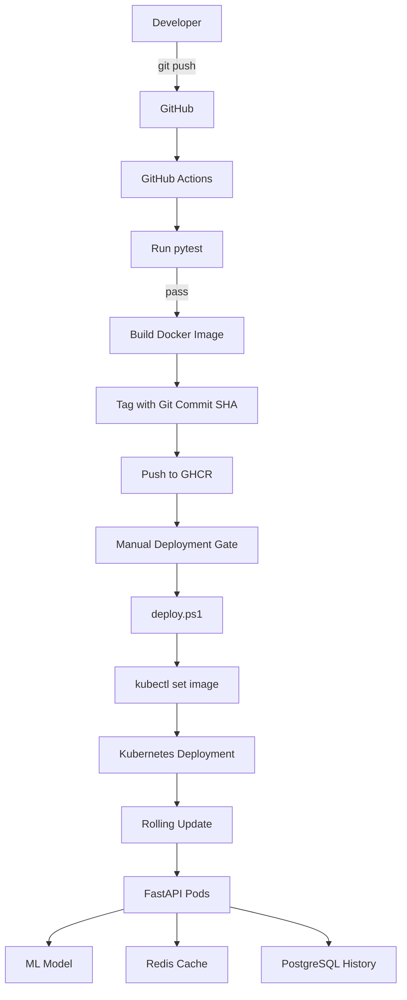
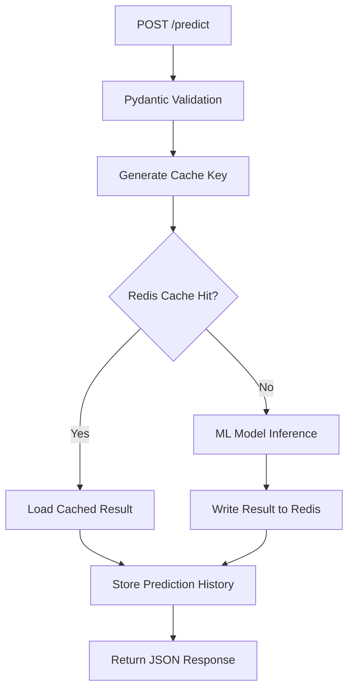

# MLOps Model Serving Demo

A small end-to-end MLOps project that demonstrates how a machine learning model can be tested, containerized, deployed, and operated as an API service.

The project focuses on the full serving lifecycle rather than model complexity:

**Source Code → CI → Container Registry → Controlled Deployment → Kubernetes → Model Serving**

It also integrates Redis for prediction caching and PostgreSQL for prediction history.

---

## Architecture Overview



### Current Environment

The project currently uses two execution environments:

- **Docker Compose** for the complete local runtime:
  - FastAPI
  - Redis
  - PostgreSQL
- **Kubernetes** for demonstrating the FastAPI deployment lifecycle:
  - Deployment
  - ReplicaSet / Pods
  - Service
  - Liveness and Readiness Probes
  - Resource Requests and Limits
  - ConfigMap / Secret
  - Private GHCR image pulling

Redis and PostgreSQL are currently **not deployed inside Kubernetes**.

---

## Main Components

### FastAPI

FastAPI acts as the application/API layer.

It is responsible for:

- HTTP request handling
- Request validation
- ML model inference
- Redis cache access
- PostgreSQL prediction history
- Health endpoints

The application is served by **Uvicorn** on port `8000`.

---

### ML Model

The demo serves an Iris classification model stored as:

```text
models/model.joblib
```

Model metadata is loaded from:

```text
models/metadata.json
```

During application startup, the model performs a small inference sanity check before the application is marked as ready.

---

### Redis

Redis is used as a prediction cache.

```text
Prediction Request
       ↓
Check Redis
   ├── Cache Hit → Return cached prediction
   │
   └── Cache Miss
          ↓
      Model Inference
          ↓
      Write Cache
          ↓
      Return Result
```

The cache key includes both:

- model version
- input features

This prevents cached predictions from an older model version from being reused incorrectly.

Redis is treated as an **optional dependency**.

If Redis becomes unavailable:

```text
Redis unavailable
       ↓
Skip cache
       ↓
Run model inference
       ↓
Prediction still succeeds
```

This provides graceful degradation for the core `/predict` endpoint.

---

### PostgreSQL

PostgreSQL stores prediction history.

Each prediction record contains information such as:

- input features
- predicted class
- predicted label
- model version
- creation time

For `/predict`, prediction-history persistence is treated as an optional function.

Therefore:

```text
PostgreSQL unavailable
       ↓
History cannot be stored
       ↓
Model inference still works
```

However, PostgreSQL is a critical dependency for history endpoints such as:

```text
GET /predictions
GET /predictions/{id}
DELETE /predictions/{id}
```

If PostgreSQL is unavailable, these endpoints return `503 Service Unavailable`.

---

## Prediction Request Flow



The application is designed so that Redis and PostgreSQL failures do not prevent the model from serving predictions.

---

## Health Checks

Two separate health endpoints are provided.

### Liveness

```http
GET /health/live
```

Used to determine whether the application process is alive.

Example:

```json
{
  "status": "alive"
}
```

A persistent liveness failure allows Kubernetes to restart the container.

### Readiness

```http
GET /health/ready
```

Used to determine whether the application is ready to receive traffic.

The ML model is treated as a **critical dependency**.

If model loading or the startup sanity check fails:

```text
model_ready = false
↓
/health/ready = 503
↓
Kubernetes does not send traffic to the Pod
```

Redis and prediction-history PostgreSQL availability are reported by the health endpoint, but they do not make the `/predict` service unavailable.

Example:

```text
status             : ready
model_loaded       : True
model_version      : 4
redis_available    : True
postgres_enabled   : True
postgres_available : True
```

---

## CI Pipeline

GitHub Actions is used for Continuous Integration.

```text
git push
   ↓
GitHub Actions
   ↓
pytest
   ↓
Build Docker Image
   ↓
Tag Image with Git Commit SHA
   ↓
Push Image to GHCR
```

The build job only runs after tests succeed.

Using the Git Commit SHA as the Docker image tag provides:

- traceability
- reproducibility
- easier rollback

Example:

```text
ghcr.io/yiyi2525/mlops-demo:<git-commit-sha>
```

Unlike `latest`, a commit SHA identifies a specific version of the source code.

---

## Deployment

Deployment currently follows a **Continuous Delivery** approach.

The CI pipeline automatically:

```text
Test
→ Build
→ Push Image
```

Deployment to Kubernetes requires an explicit manual action.

```powershell
.\scripts\deploy.ps1 -ImageTag <git-commit-sha>
```

The script:

1. Checks the current Kubernetes context.
2. Checks cluster connectivity.
3. Displays the image being deployed.
4. Requires manual confirmation.
5. Updates the Deployment image.
6. Waits for the Rolling Update.
7. Triggers rollback if rollout fails.
8. Displays the final Pods and running images.

---

## Kubernetes Deployment Flow

```text
deploy.ps1
     ↓
kubectl set image
     ↓
Deployment Pod Template changes
     ↓
New ReplicaSet
     ↓
New Pods
     ↓
Image pulled from GHCR
     ↓
Readiness Probe passes
     ↓
New Pods receive traffic
     ↓
Old Pods are gradually terminated
```

The Kubernetes deployment currently uses two FastAPI replicas.

### Why Deployment?

FastAPI is designed as a stateless workload.

Important state is externalized to Redis and PostgreSQL, so individual API Pods are replaceable.

Therefore a Kubernetes `Deployment` is more appropriate than a `StatefulSet`.

---

## Kubernetes Service

The local Kubernetes demo currently uses a `NodePort` Service.

```text
Host / Node
    ↓
NodePort :30080
    ↓
Service :80
    ↓
FastAPI Pod :8000
```

NodePort is sufficient for the current local Docker Desktop Kubernetes environment.

For a cloud deployment such as AKS, a `LoadBalancer` Service or Ingress would be more appropriate depending on the routing requirements.

---

## Docker Compose

The complete local environment can be started with:

```powershell
docker compose up -d --build
```

Check service status:

```powershell
docker compose ps
```

Current services:

```text
api
redis
postgres
```

The containers communicate through Docker Compose internal DNS:

```text
api → redis:6379
api → postgres:5432
```

`localhost` is not used for container-to-container communication because each container has its own network namespace.

Stop the services:

```powershell
docker compose down
```

To also delete the PostgreSQL volume:

```powershell
docker compose down -v
```

> `-v` removes persistent database data stored in the Docker volume.

---

## Environment Variables

Create a local `.env` file:

```env
POSTGRES_DB=mlops_demo
POSTGRES_USER=mlops_user
POSTGRES_PASSWORD=<your-password>
```

The `.env` file should not be committed to Git.

Docker Compose provides the API container with settings such as:

```text
REDIS_HOST=redis
REDIS_PORT=6379
CACHE_TTL_SECONDS=300

DB_HOST=postgres
DB_PORT=5432
DB_ENABLED=true
```

---

## API Endpoints

| Method | Endpoint | Description |
|---|---|---|
| GET | `/health/live` | Liveness check |
| GET | `/health/ready` | Readiness and dependency status |
| GET | `/metadata` | Model metadata |
| GET | `/version` | API version |
| POST | `/predict` | Run model prediction |
| GET | `/predictions` | List prediction history |
| GET | `/predictions/{id}` | Get one prediction record |
| DELETE | `/predictions/{id}` | Delete one prediction record |

Example prediction request:

```json
{
  "features": [5.1, 3.5, 1.4, 0.2]
}
```

Example response:

```json
{
  "predicted_class": 0,
  "predicted_label": "setosa",
  "probabilities": {
    "setosa": 1.0,
    "versicolor": 0.0,
    "virginica": 0.0
  },
  "model_version": "4",
  "cache_hit": false
}
```

Repeating the same request can produce:

```json
{
  "cache_hit": true
}
```

when the prediction exists in Redis.

---

## Testing

Tests are executed with:

```powershell
python -m pytest -q
```

Current result:

```text
5 passed
```

The automated test suite validates core API and model-serving behavior before a Docker image is built by CI.

This prevents known broken versions from progressing further through the delivery pipeline.

---

## Failure Handling

The project intentionally tests several failure scenarios.

### Redis Failure

```text
Redis Down
↓
Cache unavailable
↓
Model inference continues
↓
/predict still succeeds
```

### PostgreSQL Failure

```text
PostgreSQL Down
↓
Prediction history unavailable
↓
/predict still succeeds
```

History-specific endpoints return `503`.

### Model Failure

```text
Model cannot load
↓
Readiness fails
↓
/health/ready returns 503
↓
Pod does not receive Service traffic
```

### Deployment Failure

```text
New deployment
↓
Rolling Update fails
↓
deploy.ps1 detects failure
↓
kubectl rollout undo
```

---

## Project Structure

```text
mlops-demo/
│
├── app/
│   └── main.py
│
├── models/
│   ├── model.joblib
│   └── metadata.json
│
├── tests/
│
├── k8s/
│   └── deployment.yaml
│
├── scripts/
│   └── deploy.ps1
│
├── .github/
│   └── workflows/
│       └── ci.yml
│
├── Dockerfile
├── docker-compose.yml
├── requirements.txt
└── README.md
```

---

## Technology Stack

- Python
- FastAPI
- Uvicorn
- scikit-learn
- Docker
- Docker Compose
- Redis
- PostgreSQL
- Kubernetes
- GitHub Actions
- GitHub Container Registry
- pytest

---

## Design Decisions

The project intentionally keeps the architecture small enough to understand end-to-end.

Some design choices include:

- **Git Commit SHA instead of `latest`**  
  Provides traceability between source code and deployed image.

- **Continuous Delivery instead of fully automated deployment**  
  Keeps a manual deployment gate before modifying the Kubernetes workload.

- **Redis as an optional dependency**  
  Cache failure should not stop model inference.

- **PostgreSQL history as optional for `/predict`**  
  Persistence failure should not stop the core prediction service.

- **Deployment instead of StatefulSet**  
  FastAPI Pods are stateless and replaceable.

- **NodePort for the local Kubernetes demo**  
  A cloud LoadBalancer or Ingress is unnecessary for the current single-service local environment.

---

## Possible Production Improvements

The current project is designed as an MLOps / DevOps demonstration rather than a full production platform.

Possible future improvements include:

- Prometheus and Grafana for metrics and dashboards
- HPA for Pod autoscaling
- Argo CD for GitOps-based deployment
- Helm or Kustomize for multi-environment configuration
- Azure AKS and ACR
- Managed Redis and PostgreSQL
- Azure Key Vault / Managed Identity
- Ingress and TLS
- Centralized logging and tracing
- Load testing
- Canary or Blue-Green deployment
- Backup and disaster recovery strategy

---

## Summary

This project demonstrates an end-to-end model serving workflow:

```text
Source Code
↓
Automated Testing
↓
Docker Image
↓
GHCR
↓
Controlled Kubernetes Deployment
↓
FastAPI Model Serving
├── Redis Cache
└── PostgreSQL History
```

The main focus is not the complexity of the ML model itself, but the engineering required to make a model service **deployable, observable, recoverable, and easier to operate**.